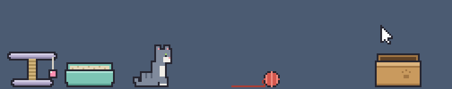
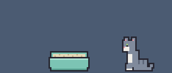
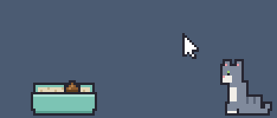
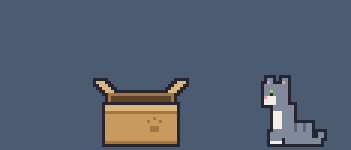
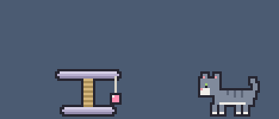
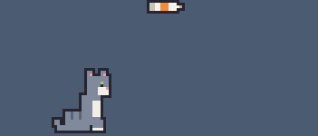
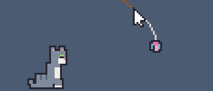

# 毛球貓 YarnCat



一隻住在螢幕底部的原創像素貓。你辦公，牠在旁邊玩毛球：盯著球、壓低身體扭屁股、飛撲、用前掌撥，玩累了就趴下睡覺。也可以換成雷射光或逗貓棒，用滑鼠陪牠玩。地上還擺著貓砂盆、貓跳台和紙箱，牠會自己去上廁所、磨爪、撥小毛球，偷偷躲進紙箱嚇你。

## 展示

| 自己去上廁所，點一下貓砂盆就鏟掉便便 | 盆子翻倒、便便亂丟，貓聞到臭就對地板扒 |
| :---: | :---: |
|  |  |
| **偷偷躲進紙箱，摸一下紙箱就蹦出來嚇你** | **抓柱子磨爪；點一下貓跳台，牠就跑來撥小毛球** |
|  |  |
| **貓條要拿到嘴邊才舔得到，拿多高就站多高** | **冒愛心泡泡討摸，游標來回滑就是在摸牠** |
|  |  |
| **雷射光：追著紅點跑、跳起來拍** | **逗貓棒：跳起來抓住羽毛，吊在上面晃** |
|  |  |

動畫是用網頁版錄的（重錄方法見 `tools/README.md`）。桌寵版的背景是透明的，貓直接站在工作列上面。

## 安裝

### Windows

**Microsoft Store（建議）**：到 [Microsoft Store](https://apps.microsoft.com/detail/9nrj7lgz2jkd?hl=zh-TW&gl=TW) 安裝。商店版有微軟的簽章，不會跳出「Windows 已保護您的電腦」，也不會被「智慧型應用程式控制」擋下來，之後由商店自動更新。

已經裝了 GitHub 版的話，先到「設定」→「應用程式」→「已安裝的應用程式」把 YarnCat 解除安裝。兩個是分開的程式，同時開會出現兩隻貓。

**GitHub 安裝檔**：

1. 到 [Releases](../../releases) 下載最新的 `YarnCat_x.x.x_x64-setup.exe`。
2. 雙擊安裝。
3. 因為安裝檔沒有程式碼簽章，Windows 可能會跳出「Windows 已保護您的電腦」。按「其他資訊」→「仍要執行」即可。
4. 如果跳出的是「**智慧型應用程式控制**已封鎖可能不安全的應用程式」，這個畫面沒有「仍要執行」可以按，改從 Microsoft Store 安裝就不會被擋。
   這是 Windows 11 一項較嚴格的防護，會擋下所有沒有簽章的程式。一定要用安裝檔的話，只能把它關掉：
   「Windows 安全性」→「應用程式與瀏覽器控制」→「智慧型應用程式控制設定」→「關閉」。
   - 關掉會降低整台電腦的防護，請自行斟酌。
   - 在某些 Windows 版本上，關掉之後要重設 Windows 才能再打開，畫面上會有說明。
   - 不想關的話，可以用瀏覽器直接打開 `src/index.html` 玩網頁版（沒有點擊穿透，貓會擋住後面的視窗）。

### macOS（測試版）

1. 到 [Releases](../../releases) 下載最新的 `YarnCat_x.x.x_universal.dmg`。
2. 打開 dmg，把 YarnCat 拖進「應用程式」。
3. 因為安裝檔沒有簽章，直接打開會說「YarnCat 已損毀」。先打開「終端機」執行一次：
   ```
   xattr -cr /Applications/YarnCat.app
   ```
   之後就能正常打開。

## 怎麼玩

貓只在工作列上方一條窄窄的長條裡活動，透明的地方滑鼠會直接點到後面的程式。

- **貓**：拖住可以拎起來，放開會掉下去。游標在牠身上左右來回滑（不用按）就是在摸牠。
- **毛球**：抓住甩出去，貓會追。
- **家具**：貓砂盆、貓跳台、紙箱都可以拖去別的地方，拎高放開會掉下來。
  - **貓砂盆**：貓會自己去上廁所。點一下就鏟掉便便，積太多牠會嫌髒不肯進去。拎高放開或用力甩會翻倒，點一下翻回來。
  - **便便**：可以抓起來亂丟，貓會湊過去聞，臭到皺臉、對著地板扒。點一下就鏟掉。
  - **貓跳台**：貓會抓柱子磨爪、跳上平台睡覺。點一下，平台邊的小毛球晃起來，牠就跑過來撥；偶爾也會自己去撥。
  - **紙箱**：貓會偷偷躲進去探頭偷看，摸摸紙箱或點一下，牠就蹦出來嚇你。把貓丟進去，牠就躲在裡面。
- **貓條**：從系統匣的右鍵選單餵。貓自己打不開，要抓起來拿到牠嘴邊才舔得到。
- **泡泡**：貓每隔一兩分鐘會冒泡泡，點一下有反應。愛心泡泡是想被摸，零食泡泡會掉下妙脆角或貓條，大泡泡裡是「泡泡圖片資料夾」裡的圖片（資料夾空的就不會出現）。

系統匣的貓咪圖示（Windows 在右下角，macOS 在右上角選單列）：

**左鍵**打開狀態視窗，點到別的地方就收起來。毛色、家具、螢幕、連線選好會記住，重開也一樣。

- **狀態**：貓現在在做什麼、體力、貓砂盆積了幾坨。
- **毛色**：藍灰虎斑、橘貓、黑白賓士。裝了 DLC 會多出 DLC 的毛色（見下面的「DLC」）。
- **家具**：個別收起來、擺出來。裝了 DLC 會多出 DLC 的家具。
- **螢幕**：有接副螢幕時，選貓待在哪個螢幕。
- **連線**：跟同一個區網的另一台電腦連線，讓兩隻貓互相串門子（見下面的「串門子」）。
- **系統**：打開泡泡圖片資料夾、打開 DLC 資料夾、結束毛球貓。泡泡圖片資料夾是 `圖片\YarnCat`（macOS 是 `~/Pictures/YarnCat`），支援 PNG、JPG、GIF（只顯示第一格）、WebP、BMP，單張 20 MB 以內，放進去不用重開。

**右鍵**是選單，放當下要用的。這些不記，重開會回到毛球、不安靜：

- **玩具**：毛球、雷射光（紅點跟著游標）、逗貓棒（羽毛垂在游標下方）。
- **餵貓條**：在貓面前掉一條貓條。
- **安靜模式**：開會、分享螢幕時讓貓去睡覺。
- **狀態與設定…**：跟按左鍵一樣。
- **結束毛球貓**。

### 串門子

兩台電腦都裝了毛球貓、接在同一個區網上（例如同一台路由器），兩隻貓就會互相拜訪：貓偶爾走出畫面，到隔壁電腦作客一兩分鐘，跟那邊的貓碰鼻子、給那邊的人摸，再走回家。不經過伺服器，兩台電腦直接連。

1. 兩台都左鍵點系統匣圖示，到「連線」分頁打開開關。
2. Windows 第一次會跳出防火牆詢問：「私人網路」「公用網路」都勾起來，再按「允許存取」（要系統管理員權限）。很多電腦的網路被標成「公用」，只勾私人網路會連不上。macOS 會問要不要允許尋找區域網路上的裝置，按「允許」。
3. 「找到的電腦」出現對方之後，兩邊互相勾選對方，顯示「已連上」就好了。之後重開會自動連回去。
4. 不想等的話，到「狀態」分頁按「叫牠去隔壁玩」；貓在隔壁時可以按「叫牠回家」。

- 貓走出去的方向不對：在「連線」分頁的「隔壁在我的」改成左邊或右邊。
- 找不到對方：
  - 確認兩台都打開了連線。
  - 防火牆詢問時按了取消的話，到「Windows 安全性」→「防火牆與網路保護」→「允許應用程式通過防火牆」，把 YarnCat 的「私人」「公用」都勾起來。
  - 兩台不在同一個網段（例如公司按樓層切網段）時廣播傳不過去：在「連線」分頁輸入對方的 IP（寫在對方「連線」分頁的最下面），只要一邊輸入就好。
- 開了安靜模式、貓沒體力、家裡有客人時，貓不會出門。

### DLC

DLC 是一個 `.yarncat` 檔，裝了會多出新的毛色或家具，有的還有自己的動作。商店版、GitHub 版裝法一樣：

1. 左鍵點系統匣圖示，到「系統」分頁按「打開 DLC 資料夾」，把 `.yarncat` 檔放進去。這個資料夾就是 `圖片\YarnCat\dlc`（macOS 是 `~/Pictures/YarnCat/dlc`）。
2. 在系統匣按右鍵選「結束毛球貓」，再重新打開。
3. 到「毛色」分頁選新的毛色。DLC 的家具會直接擺出來，每一隻貓都會用；不要的話到「家具」分頁收起來。

「打開 DLC 資料夾」底下會寫載入了哪些；出錯的話也寫在那裡。

DLC 是程式碼，會在毛球貓裡執行：只裝信任的人給的檔案。

## 原理

| 部分 | 檔案 | 做什麼 |
| --- | --- | --- |
| 透明長條視窗 | `src-tauri/tauri.conf.json` | 透明、無邊框、置頂、不出現在工作列 |
| 擺放位置 | `src-tauri/src/main.rs` `pick_monitor`、`strip_rect`、`Placer` | 在狀態視窗選的螢幕（預設主螢幕）扣掉工作列的範圍，擺在最底部；每秒檢查一次，換螢幕、改縮放、搬工作列後自動重擺 |
| 點擊穿透 | `main.rs` `watch_cursor` + `src/index.html` `hitTest` | Rust 每 16ms 回報游標位置（毛球模式只在游標進到長條時回報），前端判斷在不在貓或毛球上，再開關穿透 |
| 貓的行為 | `src/index.html` `updateCat`、`nextHunt` | 狀態機：坐、舔毛、盯、追、撲、撥、睡；雷射光、逗貓棒另外有追、壓低、跳起來拍、抓住吊著，搆不到時趴成麵包盯著、翻肚放棄；家具另外有上廁所（`toLitter` → `squat` → `cover`）、聞便便（`sniffGo` → `sniff` → `stink` → `bury`）、去貓跳台（`toTree` → `scratch`、跳上平台）、撥小毛球（`toPom` → `pom`）、躲紙箱（`toBox` → `hide` → `boo` → `spook`） |
| 家具、便便 | `src/index.html` `updateFurniture`、`settle`、`tipLitter`、`scoopLitter` | 家具、便便都有重力、落地、地面摩擦，往上甩太用力會撞到長條頂端彈回來；貓砂盆落地太快就翻倒、把盆裡的便便噴出來；點貓砂盆或便便就用鏟子（`updateScoop`）鏟掉 |
| 貓條 | `src/index.html` `giveTreat`、`treatTip`，`updateCat` 的 `treat` 狀態 | 躺在地上時貓只會坐在旁邊盯；拿在手上時看開口離地多高，決定低頭、坐著、站起來舔還是搆不到 |
| 毛球 | `src/index.html` `updateBall` | 重力、摩擦、反彈，線頭用 Verlet 積分 |
| 雷射光、逗貓棒 | `src/index.html` `updateLaser`、`updateWand` | 紅點、逗貓棒的線都掛在游標上（`watch_cursor` 回報的位置） |
| 泡泡、摸貓、妙脆角 | `src/index.html` `bubbleBox`、`stroke`、`popBubble`、`updateFx` | 閒著時偶爾進入討摸（`beg`）、流口水（`drool`）或望著圖片發呆（`dream`）狀態並畫出泡泡；點泡泡、或游標在貓身上來回滑就觸發被摸（`pet`）、走去吃（`fetch` → `eat`） |
| 大泡泡的圖片 | `main.rs` `list_pictures`、`read_picture`、`open_picture_dir` + `src/index.html` `preparePic`、`fitPic`、`showPic` | 快冒泡泡前先擲骰子，擲到大泡泡才從資料夾隨機挑一張讀進來、縮成泡泡大小。圖片用螢幕實際的解析度畫在主畫布底下的另一個 canvas，主畫布在泡泡裡挖洞讓它透出來，照片才不會變成馬賽克 |
| 系統匣 | `src-tauri/src/main.rs` `main` | 右鍵選單換玩具、餵貓條、安靜模式、結束，用事件通知前端；左鍵開關狀態視窗 |
| 狀態視窗 | `src/status.html` + `main.rs` `toggle_status_window`、`place_status_window` + `src/index.html` `catStatus`、`catPicture` | 沒有標題列的小視窗，擺在系統匣圖示旁邊，點到別的地方就收起來。開著時貓的視窗每半秒送一次狀態過去；貓的小圖是用貓自己的畫法，照牠現在的姿勢畫的 |
| 設定 | `main.rs` `Settings`、`update_settings` | 毛色、家具、螢幕、連線設定存在 app 設定資料夾的 `settings.json`，改了就存檔、通知所有視窗；讀不到或格式不對就用預設值 |
| 串門子 | `src/index.html` `onLink`、`linkTick`、`updateGuest` | 貓在誰的畫面上就由誰跑牠的動作，整隻走出邊界時才傳一則訊息交接（出門 `leave` → 不在家 `away` → 回家 `arrive`），每秒互相打招呼對帳，訊息掉了也會自己修好。隔壁來的客人貓沿用同一套姿勢、換毛色畫，主人家的貓會走過去碰鼻子（`meet` → `boop`）。網頁版用 BroadcastChannel 讓兩個視窗互當隔壁，桌寵版走下面的區網連線，訊息一樣 |
| DLC | `main.rs` `read_dlc` + `src/index.html` 的「角色」「DLC」段落 | 開機時讀 `圖片\YarnCat\dlc` 裡的 `.yarncat` 檔（JavaScript），照檔名順序各跑一次，每個包在自己的函式裡。DLC 在 `COATS` 加毛色、在 `CHARS` 登記角色，主程式在幾個地方（`hook`）問現在這隻有沒有專屬的動作、姿勢、東西；在 `FURN` 加的家具不管哪一隻貓都會用，主程式在同樣的地方問擺出來的每一件（`furnAsk`、`furnEach`）。DLC 載入時出錯就整個不載入，跑到一半出錯就停掉那個角色、收掉那件家具，畫面不會停住 |
| 區網連線 | `src-tauri/src/link.rs` + `main.rs` 的「串門子」段落 | 打開「連線」才開 port 52525：每 2 秒用 UDP 廣播到每張網卡的廣播位址找人，兩邊互相勾選後用 TCP 連線，一行一則 JSON 原封不動轉給前端。代號小的那台先撥，連不上再換另一台撥，防火牆只擋一邊時也連得上 |

直接用瀏覽器打開 `src/index.html` 也能玩（沒有點擊穿透），改行為時這樣測最快。按 `1` `2` `3` 切換毛球、雷射光、逗貓棒，按 `4` `5` 直接叫出愛心泡泡、零食泡泡，按 `7` 掉一條貓條，按 `8` `9` `0` 讓貓想上廁所、想躲紙箱、想去貓跳台（閒著的話馬上去）。網頁版沒有系統匣和狀態視窗，家具不能收起來；`src/status.html` 可以直接用瀏覽器打開，用假資料看狀態視窗的版面。網頁版也沒有泡泡圖片資料夾，改成把圖片拖進視窗（重新整理就要再拖一次）：拖進去會馬上冒一次大泡泡，之後按 `6` 再叫出來。

開兩個並排的瀏覽器視窗，就像兩台互為隔壁的電腦：貓偶爾會走出靠對方那一邊，到隔壁作客一兩分鐘（跟那邊的貓碰鼻子、給那邊的人摸），再走回家。按 `v` 叫貓馬上去隔壁（閒著的話），按 `c` 換毛色（藍灰、橘貓、黑白；兩隻一樣的話會自動錯開）。

測 DLC：把 `.yarncat` 檔拖進視窗，畫面會重新整理一次，再按 `c` 換到 DLC 的毛色；DLC 的家具會直接擺出來。拖進去的 DLC 存在那個分頁裡，重新整理也還在，關掉分頁就沒了；改了檔案就再拖一次。DLC 的角色、家具可能有自己的按鍵，寫在那個 DLC 的說明裡。

## 自己編譯

需要 [Rust](https://www.rust-lang.org/tools/install) 和 [Node.js](https://nodejs.org/)：

```
npm install
npm run tauri dev
```

## 隱私

毛球貓不會連上網際網路，也不會把任何資料傳給開發者或其他人。

- 程式裡沒有統計、廣告或自動更新功能。
- 串門子的「連線」預設關閉。打開之後才會在區網上廣播這台的電腦名稱，讓同一個區網裡的毛球貓找得到；跟你勾選的那台直接互傳貓的狀態（毛色、安靜模式、貓在誰家、體力），不經過任何伺服器，不傳游標位置和圖片。關掉就停止，port 也跟著關掉。
- 毛球貓自己存下來的只有你選的毛色、家具、螢幕、日記開關和連線設定（開關、勾選的那台、手動輸入的 IP、這台的隨機代號），以及下面的貓咪日記。設定放在自己電腦上 app 的設定資料夾（`settings.json`），不會傳到任何地方。顯示畫面用的 WebView2 另外會在 AppData 裡放它自己的快取。
- 貓咪日記：只在你的電腦上記錄貓咪日記，不會傳到任何地方，可以在狀態視窗的「系統」分頁關掉。日記放在 `圖片\YarnCat\diary.json`（macOS 是 `~/Pictures/YarnCat/diary.json`），只記每天的次數和時間（玩了多久玩具、摸了幾次、吃了幾次零食之類），留最近 30 天，給之後的外傳遊戲讀。
- 游標位置只用來讓貓追玩具、判斷你有沒有點到貓，不會記錄下來。
- 泡泡圖片資料夾裡的圖片只在你的電腦上讀取、畫在泡泡裡，不會傳到任何地方。
- 例外是安裝和更新：GitHub 版的安裝程式在電腦裡沒有 Microsoft Edge WebView2 時，會向微軟下載安裝（這是 Windows 顯示畫面用的元件）；商店版的下載、更新由 Microsoft Store 進行。這些過程都由微軟處理。
